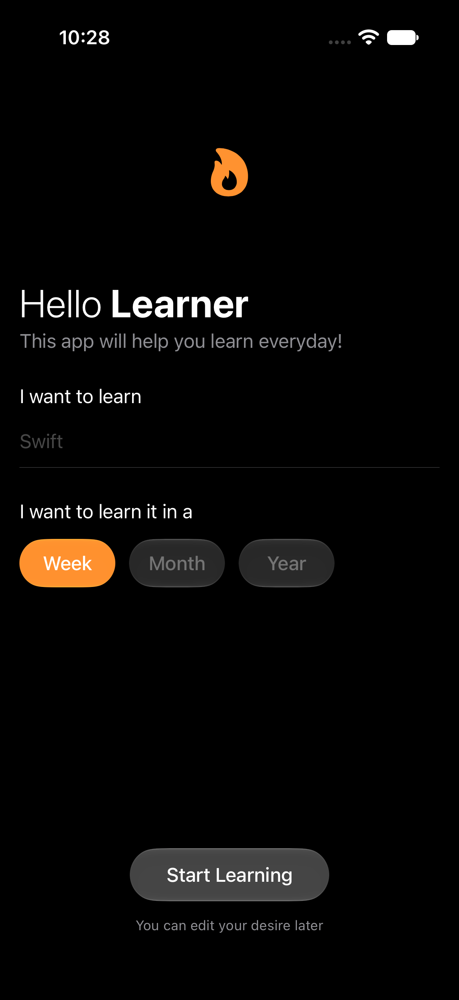
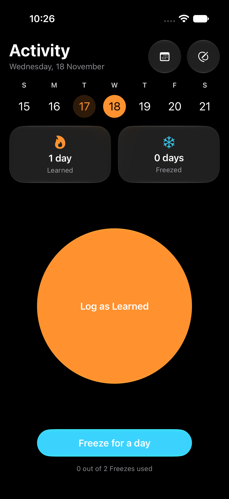
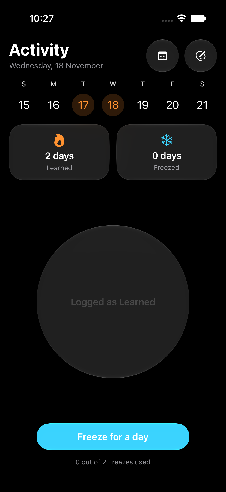
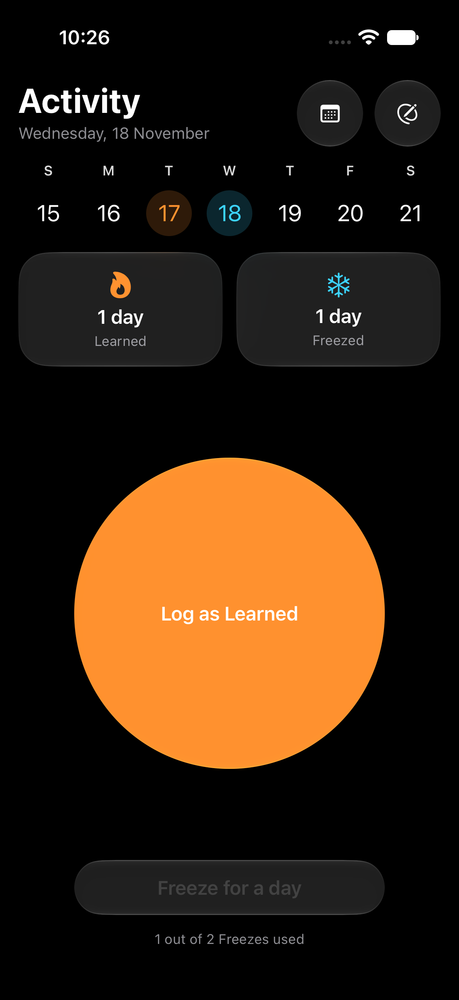
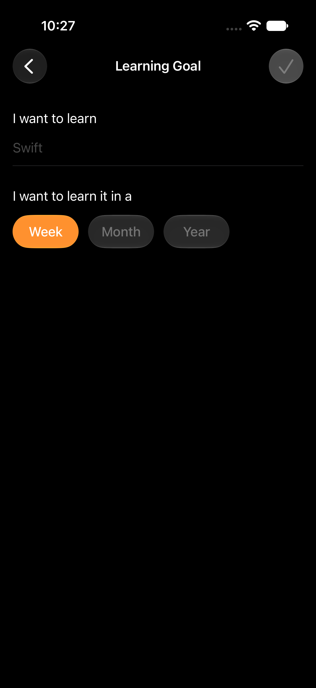
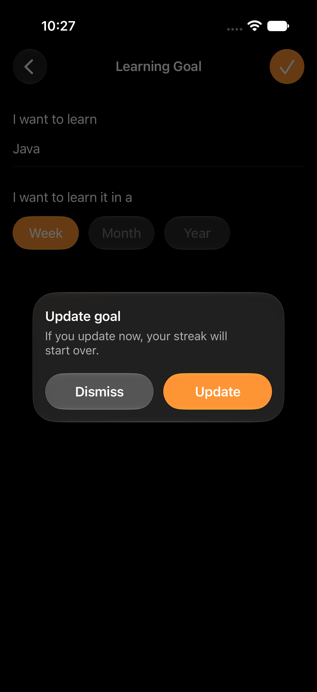
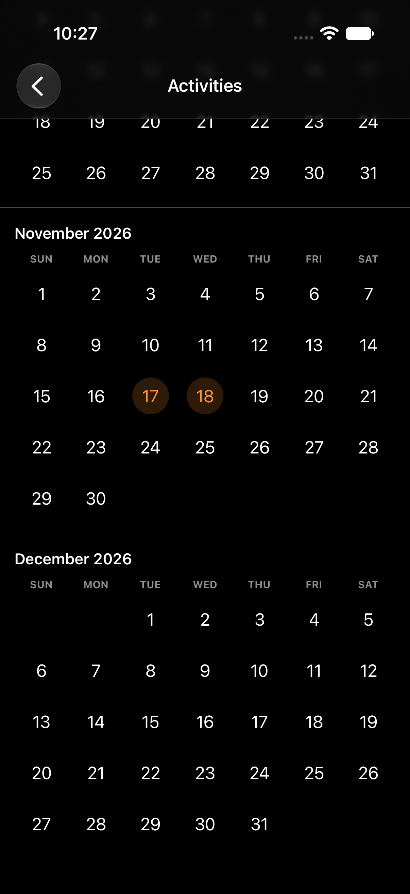

# Learning Journey

A SwiftUI app that helps you build a daily learning habit. Pick something to learn and how long you want to take, then log each day as **learned**, or use a **freeze** when you can't. Finish every day of your goal to complete it; miss a day and the streak starts over.

The UI is built for **iOS 26** and uses native **Liquid Glass** components.

---

## Features

- **Onboarding** – choose a subject (e.g. *Swift*) and a duration (Week / Month / Year).
- **Activity screen** – week strip, Learned / Freezed counters, a big *Log as Learned* button and a *Freeze for a day* button with a freeze counter.
- **Goal results** – a *Well done!* or *You didn't reach your goal this time* screen when a goal ends, with a shortcut to set the next goal.
- **Update goal** – a pushed page to change the subject or duration, with a "your streak will start over" alert.
- **Calendar** – a view-only, scrolling month-by-month calendar of learned and frozen days.
- **Persistence** – progress and the current goal are saved on the device.

---

## UI

All screens use a black background with orange (learned) and cyan (freezed) accents, and Liquid Glass buttons and cards.

### Getting started and daily use

<table>
  <tr>
    <th align="center">Onboarding</th>
    <th align="center">Activity – default</th>
    <th align="center">Activity – logged</th>
    <th align="center">Activity – freezed</th>
  </tr>
  <tr>
    <td align="center"></td>
    <td align="center"></td>
    <td align="center"></td>
    <td align="center"></td>
  </tr>
  <tr>
    <td valign="top">Choose what to learn and for how long, then tap <b>Start Learning</b>.</td>
    <td valign="top">Today isn't logged yet: <b>Log as Learned</b> and <b>Freeze for a day</b> are both available.</td>
    <td valign="top">Today is logged: the circle turns dark and is disabled, and the Learned counter goes up.</td>
    <td valign="top">Today is freezed (blue). <b>Freeze for a day</b> is disabled and the freeze counter shows 1 out of 2 used.</td>
  </tr>
</table>

### Goal and history

<table>
  <tr>
    <th align="center">Learning Goal</th>
    <th align="center">Update goal alert</th>
    <th align="center">Calendar</th>
  </tr>
  <tr>
    <td align="center"></td>
    <td align="center"></td>
    <td align="center"></td>
  </tr>
  <tr>
    <td valign="top">Change the subject or duration. The checkmark stays disabled until a subject is entered.</td>
    <td valign="top">Changing a goal in progress asks for confirmation: updating restarts the streak.</td>
    <td valign="top">View-only calendar. Learned days are orange, freezed days are cyan, and months scroll vertically.</td>
  </tr>
</table>

---

## Requirements

| | |
|---|---|
| Xcode | 26 or later |
| Deployment target | iOS 26 or later |
| Language | Swift 6 / SwiftUI |
| Frameworks | SwiftUI, SwiftData (no third-party dependencies) |

## Getting started

1. Open the project in Xcode 26.
2. Make sure the asset catalog contains two **Color Sets**: `Orange` and `Cyan` (see [Assets](#assets)).
3. Use `MyApp.swift` as the app entry point. It creates the SwiftData container and the shared `ActivityViewModel`, then shows `RootView`.
4. Run on an iOS 26 simulator or device.

Onboarding is shown only on first launch. To see it again, delete the app from the simulator or clear the `hasCompletedOnboarding` key.

---

## Project structure

| File | Purpose |
|---|---|
| `MyApp.swift` | App entry point. Creates the SwiftData `ModelContainer` and the single shared `ActivityViewModel`. |
| `RootView.swift` | Shows onboarding on first launch, then the Activity screen. |
| `StorageModels.swift` | SwiftData models: `DayEntryRecord` (one per logged day) and `GoalRecord` (one per goal). |
| `OnboardingView.swift` | Welcome screen. Calls `onStart(subject, duration)` when *Start Learning* is pressed. |
| `ActivityView.swift` | Main screen: header, week strip, stat cards, log / freeze buttons, goal result view. Hosts the `NavigationStack`. |
| `UpdateGoalView.swift` | Pushed page to change the learning goal, with the confirmation alert. |
| `CalendarView.swift` | View-only calendar of learned and frozen days. |
| `ActivityViewModel.swift` | All app logic and state (`@Observable`). |
| Model types | `DayStatus` (`learned`, `frozen`), `Goal`, `GoalState` (`active`, `completed`, `failed`), and `LearningDuration` (`days`, `closest(toDays:)`). |

### Navigation

```
RootView
 ├─ OnboardingView ──(Start Learning)──▶ ActivityView
 └─ ActivityView  (NavigationStack)
      ├─ calendar button ──▶ CalendarView
      └─ pencil button / "Set a goal" ──▶ UpdateGoalView
```

---

## How it works

### Architecture

The app uses **MVVM** with the Observation framework. `ActivityViewModel` is the single source of truth; views only read from it and call its actions.

### Data model

- `entries: [String: DayStatus]` – one entry per day, keyed by `yyyy-MM-dd`. A day with no entry is "not logged".
- `goal: Goal` – `subject`, `startDate`, `targetDays`.

Counters (Learned, Freezed, freezes used) are **derived** from the entries, so they can never get out of sync.

### Goal rules

| Duration | Goal length | Freezes allowed |
|---|---|---|
| Week | 7 days | 2 |
| Month | 30 days | 8 |
| Year | 365 days | 96 |

- A goal is **completed** when every day from its start date is either *learned* or *frozen*.
- A goal **fails** when a past day has no entry.
- Otherwise it is **active**, and the Log / Freeze buttons are available.
- Days before the goal's start date are ignored by the Activity screen.

### Logging and freezing

- *Log as Learned* marks today as learned. If today was frozen, it becomes learned and the freeze is given back.
- *Freeze for a day* marks today as frozen. It is disabled once today is frozen, when all freezes are used, or when the goal has ended.
- Both actions are locked once a goal is completed or failed.

### Updating the goal

- While a goal is **active**, changing it shows an alert: *"If you update now, your streak will start over."* Saving without changes just goes back.
- After a goal **ended**, the confirm button sets the new goal straight away, even if the subject and duration are unchanged ("set the same goal again").
- Starting a new goal begins today and clears today's previous entry.

### Calendar

Shows the current month and every following month through December. Learned days are orange, frozen days are cyan, and today (with nothing logged) is a filled orange circle. The screen is view only.

### Persistence

| What | Stored with | Why |
|---|---|---|
| Logged / frozen days | **SwiftData** (`DayEntryRecord`, unique per `yyyy-MM-dd`) | A history that grows over time and is queried by date |
| Goals | **SwiftData** (`GoalRecord`, newest = current goal) | Keeps every goal, not just the latest |
| Onboarding completed flag | **`@AppStorage("hasCompletedOnboarding")`** | A single simple value |

All screens share **one** `ActivityViewModel`, created in `MyApp` and passed down, so they always show the same data. The view model keeps an in-memory copy for fast, observable UI updates and writes every change through to SwiftData.

Data saved by earlier versions in `UserDefaults` (`activity.entries`, `activity.goal`) is migrated into SwiftData automatically on first launch and then removed.

`ActivityViewModel` takes an optional `context: ModelContext?`. Passing `nil` (previews, tests) keeps everything in memory; `seed`, `goal` and `now` allow fixed data.

---

## Assets

Add these **Color Sets** to the asset catalog:

| Name | Used for | Suggested value |
|---|---|---|
| `Orange` | Learned days, main buttons, accents | `#F58C21` |
| `Cyan` | Frozen days, freeze button | `#64CAF2` |
